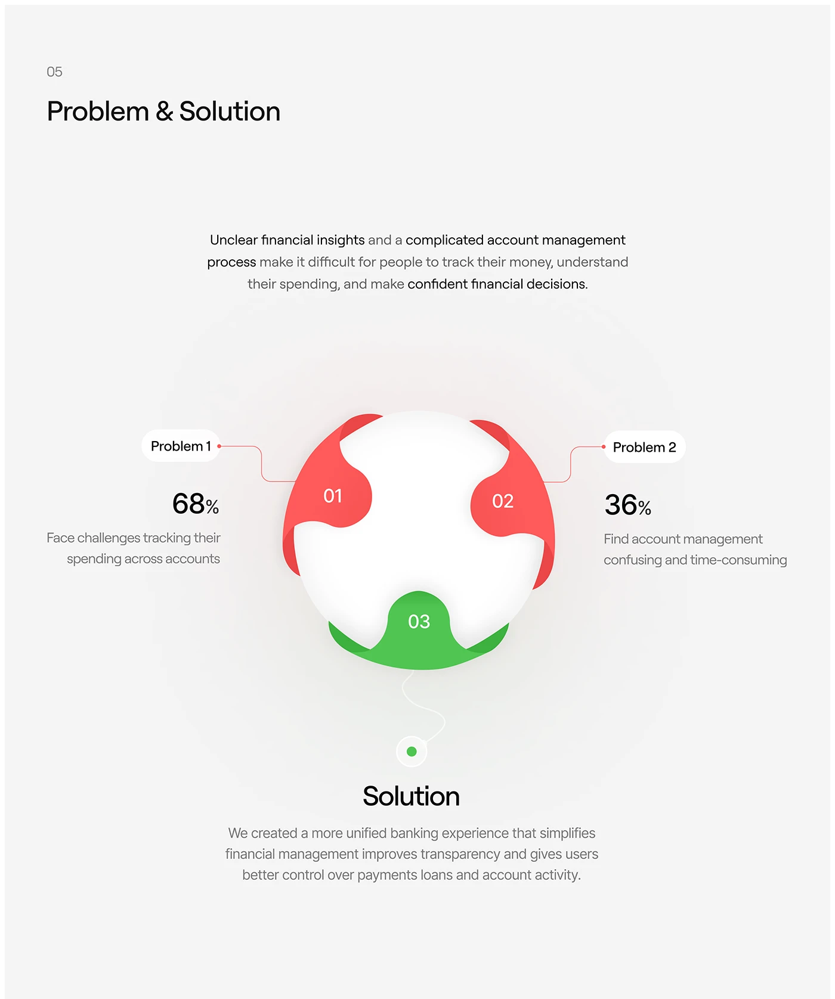

# Lobed Circle Problem and Solution Diagram

**Discipline:** app ·  · **Design style:** Gradient & Aurora
**Tags:** problem-solution, diagram, red, green, white, stats, grey

## What it is
A light grey slide titled Problem & Solution with a paragraph, a white sphere-like circle with three lobed segments (two red numbered 01 and 02, one green 03), red and green connector lines to Problem 1 and 2 labels with percentages and a Solution heading and paragraph below.

## What it means
A single circle with coloured lobes makes problems and the solution parts of one whole, and red versus green reads instantly.

## Techniques
- Lobed segments on a white circle as an infographic
- Red for problems, green for the solution
- Thin connector lines to pill labels
- Percentages set beside each problem
- Soft shadow and glow around the circle

## Best for
- Problem and solution slides
- Fintech case studies
- Single-graphic explanations

## Vocabulary
- **Lobed segment** — A rounded tab shape that fits into a circle's edge.
- **Connector label** — A pill linked by a thin line to a part of a graphic.
- **Colour semantics** — Using red and green to signal negative and positive.
