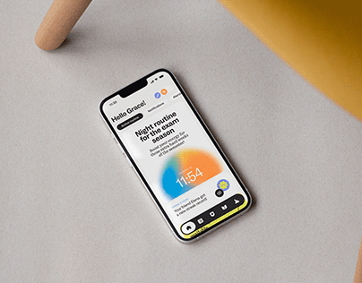

# Top-down phone on grey desk with a gradient time widget

**Discipline:** app · **Design type:** Device mockup scene
**Tags:** mockup, top-down, lock-screen, gradient-widget, neutral, yellow-accent, minimal

## What it is
A phone lying diagonally on a grey surface beside a yellow object at the top right. The screen shows a greeting, a bold notification headline, a blurred orange-blue gradient orb with the time, and a yellow bottom bar.

## What it means
Quiet and modern; the neutral desk lets the small gradient widget feel like the only warm spot.

## Techniques
- Shoot from above on a neutral surface with one colour object nearby.
- Use a blurred orange-to-blue orb as a time widget.
- Set headlines in tight grotesque bold.
- Angle the device diagonally in the frame.

## Best for
- Widget and lock-screen concepts
- Minimal app portfolio covers
- Wellness and sleep apps

## Vocabulary
- **Top-down mockup** — A device photographed from directly above.
- **Gradient orb widget** — A blurred colour sphere used as a clock or status.
- **Neutral surface** — A plain grey or beige background.
- **Accent prop** — A coloured object placed in the corner of a scene.
