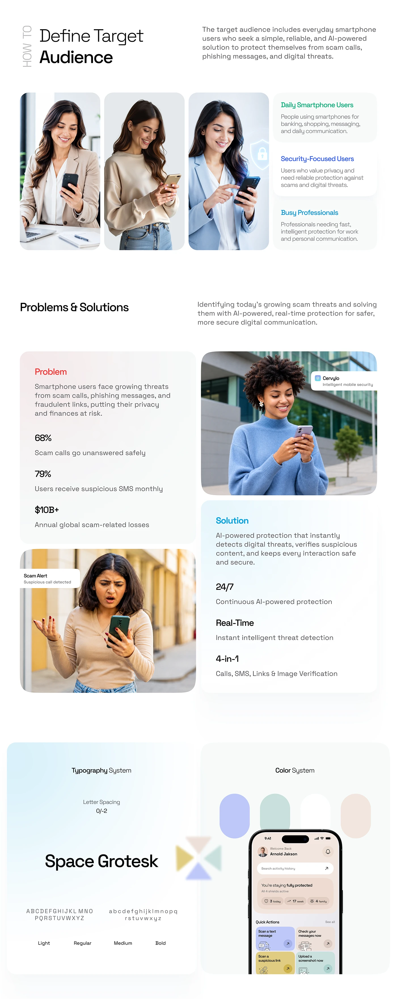

# Audience, Problem and System Long Sheet

**Discipline:** app · **Design type:** Case study slide
**Tags:** long-scroll, audience, problem-solution, typography, colour, photos, light

## What it is
A tall pale sheet with a vertical HOW TO label, three portraits of target users with descriptor cards, problem and solution cards with statistics, and typography and colour system panels ending in a phone.

## What it means
Photos with clear cards make audience and problem statements human, and pale gradients keep the density calm.

## Techniques
- Three portraits side by side beside descriptor cards
- Red Problem and blue Solution headings for instant coding
- Big numerals with one-line captions
- Two rounded panels for type and colour systems
- Vertical rotated label as a section marker

## Best for
- Long case-study pages
- Explaining audience and problem
- Security and safety app stories

## Vocabulary
- **Descriptor card** — A small card describing a user type.
- **Problem/solution pair** — Two adjacent cards contrasting an issue with the answer.
- **Rotated label** — Text turned 90 degrees as a side marker.
