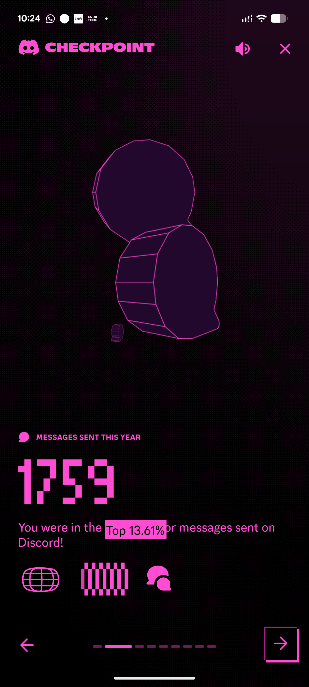

# Magenta Wireframe Stat Screen with Pixel Numerals

**Discipline:** app ·  · **Design style:** Retro & Pixel
**Tags:** magenta, wireframe, 3d, pixel-type, stat, dark, year-in-review, highlight

## What it is
A phone screenshot of a year-in-review page in near-black and hot magenta: a halftone dark background, a rotating wireframe of two chunky 3D shapes, a label 'Messages sent this year', a huge pixel-font number 1759, a sentence with the key phrase on a magenta highlight block, three glyph icons and dashes for page progress with an offset arrow tile.

## What it means
One neon hue on black with pixel numerals feels arcade-like, and the wireframe shape gives a sense of data as an object.

## Techniques
- Single hot magenta on near-black
- Wireframe 3D objects as an abstract illustration
- Giant pixel-font number as the hero stat
- Highlight block behind the key phrase
- Offset-outline arrow tile for next

## Best for
- Year-in-review and stats screens
- Neon single-colour palettes
- Pixel-type numeric displays

## Vocabulary
- **Wireframe render** — A 3D object shown only by its edges.
- **Pixel font** — A typeface built from square pixels.
- **Hero stat** — A very large number that is the focus of a screen.
