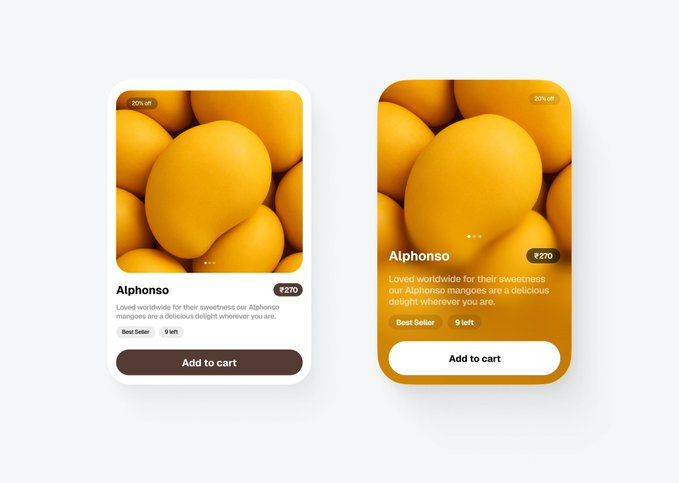

# Mango Product Card Variants

**Discipline:** app ·  · **Design style:** Warm & Organic
**Tags:** product-card, photo-card, yellow, brown, e-commerce, variants, rounded

## What it is
Two versions of a product card for Alphonso mangoes: a white card with a photo, price tag and brown Add to cart button, and a full-bleed photo card with a glassy overlay and white button.

## What it means
Strong product photography drives the mood, and the two variants show a system with range. Brown and gold keep the fruit warm.

## Techniques
- Full-bleed photo card with text over a color-graded gradient
- Brown accent chosen from the product itself
- Small pill badges (Best Seller, 9 left) for scarcity
- Discount tag on the image corner
- Same content in two layouts to compare

## Best for
- Grocery and food delivery apps
- Product card component design
- Photo-forward e-commerce

## Vocabulary
- **Photo card** — A card whose background is the image itself.
- **Scarcity badge** — A label like '9 left' encouraging action.
- **Colour picking** — Taking UI colors from the product photo.
