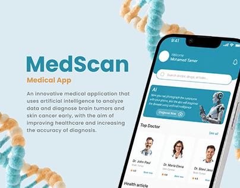

# MedScan medical app cover with a teal wordmark, AI diagnosis card and 3D DNA strands

**Discipline:** app · **Design type:** Device mockup scene · **Design style:** Corporate & Clean-Tech
**Tags:** health, ai, teal, dna, case-study-cover, doctors

## What it is
A pale blue cover with a big teal 'MedScan' title, orange 'Medical App' subtitle and a paragraph, a phone showing a greeting, search bar, teal AI 'Diagnose now' card with a robot, and a 'Top Doctor' row, framed by blurry 3D DNA helixes in the corners.

## What it means
Clinical yet friendly; DNA props tell you it's medical before you read a word.

## Techniques
- Frame the cover with a blurred 3D subject motif.
- Lead the home screen with an AI feature card.
- Pair a teal title with a warm orange subtitle.

## Best for
- Health app case studies
- AI diagnosis products
- Behance covers

## Vocabulary
- **Project cover** — The thumbnail image that introduces a case study.
- **Feature card** — A highlighted card promoting one capability.
