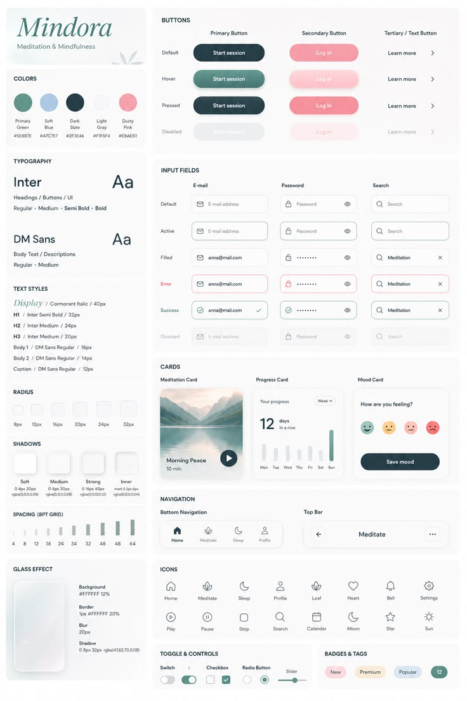

# Mindfulness Design System Sheet

**Discipline:** app ·  · **Design style:** Glassmorphism
**Tags:** design-system, sage, pink, navy, inter, glass, tokens, components

## What it is
A tall board for a meditation app named Mindora with tiles for colours, typography, text styles, radius, shadows, spacing and a glass effect, and larger panels for buttons across states, input fields across states, cards, navigation, icons, toggles and badges in sage green, soft blue, navy and dusty pink.

## What it means
Showing every state of every component in a soft palette communicates thoroughness and calm.

## Techniques
- State matrix rows (default, hover, pressed, disabled)
- Token tiles with values for radius and shadow
- Soft pastel palette with one dark navy
- Italic serif wordmark heading
- Icon grid in a single line style

## Best for
- Design-system documentation
- Wellness and meditation apps
- Component state overviews

## Vocabulary
- **State matrix** — A grid showing a component in every state.
- **Design token** — A named value for colour, radius, shadow or spacing.
- **Glass effect spec** — Values for background, border, blur and shadow of a frosted surface.
