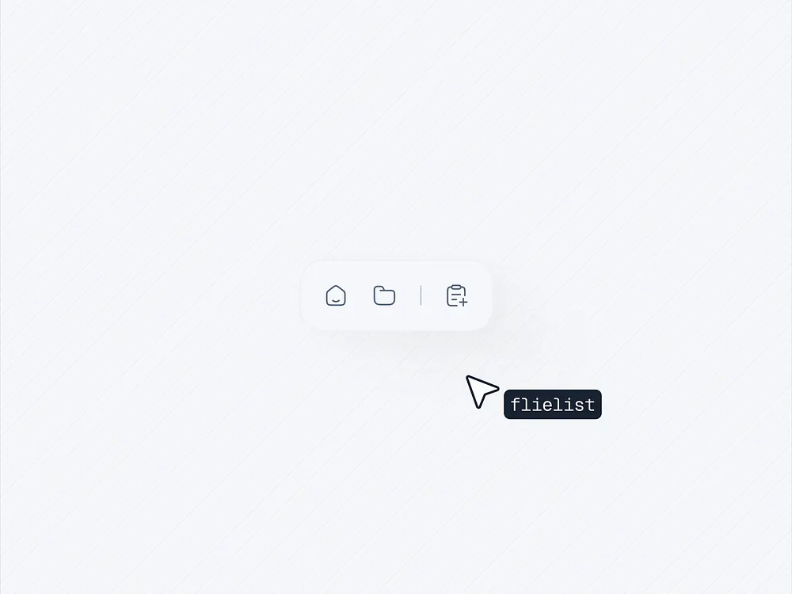

# Floating Nav Pill with Cursor Tooltip

**Discipline:** app ·  · **Design style:** Neo-Brutalist
**Tags:** navigation, floating, minimal, white, hatched, tooltip, cursor, monospace

## What it is
A near-white field with fine diagonal hatching and a small floating white pill of outline icons (home, folder, note-add) split by a hairline, with a black arrow cursor and a dark monospace tooltip reading 'flielist' beside it.

## What it means
An almost empty canvas puts all attention on the small component, and the monospace tooltip adds a technical, tool-like feel.

## Techniques
- Tiny component isolated on an empty canvas
- Soft shadow lifting a white pill from a white ground
- Hairline divider between icon groups
- Cursor with a dark monospace tooltip
- Faint diagonal hatching for texture

## Best for
- Micro-interaction studies
- Toolbar and dock components
- Minimal component showcases

## Vocabulary
- **Micro-interaction** — A small animated response to a user action.
- **Hover tooltip** — A label that appears when the pointer rests on an item.
- **Hatched ground** — A background of fine diagonal lines.
