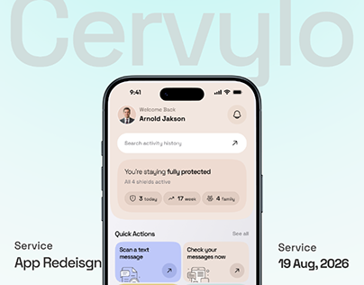

# Mint Scam Protection App Cover

**Discipline:** app ·  · **Design style:** Geometric & Bauhaus
**Tags:** mint, peach, ghost-type, security, cover, redesign

## What it is
A mint gradient cover with a phone showing a peach security home screen and lavender and yellow quick-action tiles, giant faint 'Cervylo' behind and service and date captions at the corners.

## What it means
Pastel tiles and a calm mint field make security feel gentle and approachable.

## Techniques
- Ghost brand name behind the phone
- Pastel tile colours for actions
- Corner captions for service and date
- Phone cropped at the bottom
- Soft gradient background

## Best for
- Security and safety app covers
- Redesign case studies
- Friendly utilities

## Vocabulary
- **Corner captions** — Small text at the edges of a cover naming the project.
- **Quick actions** — Tiles giving fast access to key tasks.
- **Redesign cover** — A cover framing a project as an improved version.
