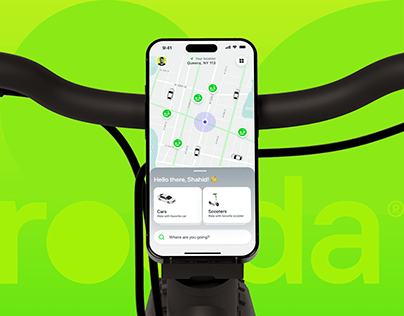

# Mobility app mounted on a bike handlebar over giant lime wordmark

**Discipline:** app · **Design type:** Device mockup scene
**Tags:** mobility, lime, mockup, handlebar, map, giant-wordmark, photographic

## What it is
A phone mounted on a black bike handlebar, filling a lime background with a huge faint wordmark behind. The screen shows a map with green pins and a bottom sheet offering Cars and Scooters and a search bar.

## What it means
Energetic and street-smart; putting the phone in its real use context sells the product.

## Techniques
- Place the device in its real environment (bike) to tell the use story.
- Fill the backdrop with a lime tint and a giant faint wordmark.
- Use bright green map pins to echo the brand colour.
- Crop the frame so the phone is centred with symmetrical hardware.

## Best for
- Micromobility, delivery and ride apps
- Case-study covers
- Brands with a neon identity

## Vocabulary
- **Context mockup** — A device shown in the environment where it will be used.
- **Ghost wordmark** — An oversized low-contrast brand name behind content.
- **Map pin accent** — Brand-coloured markers on a neutral map.
- **Bottom sheet** — A pull-up panel with choices.
