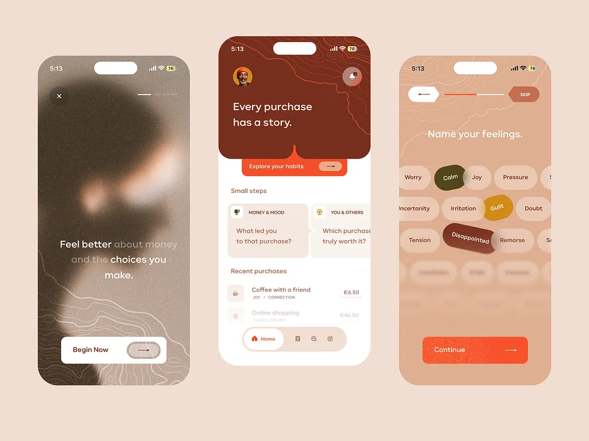

# Three rust and peach screens: blurred welcome, 'Every purchase has a story' home, and a feeling-chip picker, with topographic line texture

**Discipline:** app · **Design type:** Health app screens
**Tags:** mindfulness, finance, rust, peach, orange, topographic, chips, phones

## What it is
Three phones on peach: a blurred portrait welcome 'Feel better about money and the choices you make.' with topographic lines and a Begin Now button; a home with a rust header, an orange Explore your habits tab, small step cards and recent purchases with a pill nav; and a screen 'Name your feelings.' with peach pills, a few coloured and tilted (Calm, Guilt, Disappointed) and an orange Continue button.

## What it means
Warm and reflective; earthy rust and topographic lines make money feel human.

## Techniques
- Use topographic contour lines as texture.
- Show emotion words as tilted chips.
- Notch the header to hold a tab.
- Keep to rust, peach and orange.

## Best for
- Wellbeing and money mindfulness apps
- Earthy palettes
- Chip-based mood pickers

## Vocabulary
- **Topographic lines** — Contour-map lines as decoration.
- **Feeling chip** — A pill naming an emotion.
- **Notched header** — A header with a cut-out holding a tab.
- **Earth palette** — Rust, peach and terracotta tones.
