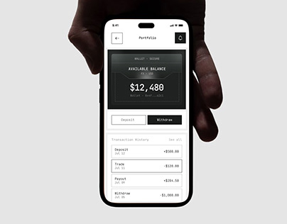

# Monochrome Wallet in a Dark Hand

**Discipline:** app ·  · **Design style:** Minimalist
**Tags:** monochrome, monospace, wallet, hand, black-white, minimal, thumbnail

## What it is
A cover image of a hand emerging from black at the top holding a phone showing a black-and-white wallet screen with a big balance and a transaction list in mono type.

## What it means
Stark black and white with monospace text feels precise, technical and trustworthy. The hand adds human scale.

## Techniques
- Dark silhouetted hand against a light backdrop
- Monospace numerals and labels for a ledger feel
- Hard outlines around list rows
- Two-button segmented control as the only interaction
- Black card as the visual focal point

## Best for
- Fintech and crypto apps
- Case-study cover thumbnails
- Brands wanting an austere look

## Vocabulary
- **Ledger styling** — Type and rules that resemble an accounting record.
- **Silhouette hand** — A hand rendered in near-black to frame the device.
- **Segmented control** — A joined pair of buttons where one is selected.
