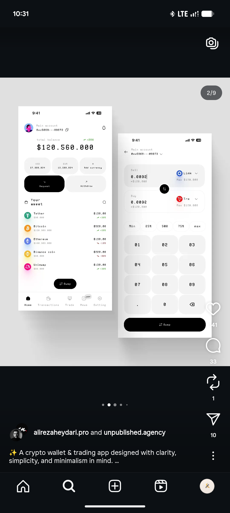

# Monospace Crypto Wallet and Swap Screens

**Discipline:** app · **Design type:** Fintech app screens
**Tags:** crypto, monospace, white, black, swap, keypad, minimal

## What it is
Two white phones set entirely in monospace type: a wallet home with a big balance in pixel-like numerals, currency pills, black Request and pale Withdraw buttons and an asset list with coin icons, and a swap screen with sell and buy fields, percentage chips, a numeric keypad and a black Swap pill.

## What it means
Monospace type gives a code-like, technical honesty to money, and black pills stay decisive against white.

## Techniques
- Monospace throughout for a terminal feel
- Large monospace balance as the hero
- Percentage chips above the keypad
- Black pill for the primary action
- Soft rounded keys on a light grey keypad

## Best for
- Developer-leaning crypto apps
- Monospace UI experiments
- Minimal swap flows

## Vocabulary
- **Monospace UI** — An interface where every character has equal width.
- **Percentage chips** — Quick buttons for choosing 25%, 50% or max of a balance.
- **Swap toggle** — A round button reversing the sell and buy assets.
