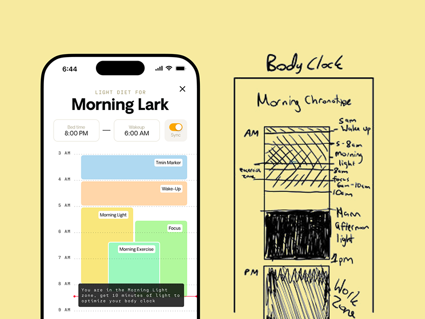

# Butter-yellow board with a 'Morning Lark' schedule phone and a hand-sketched 'Body Clock' wireframe

**Discipline:** app ·  · **Design style:** Neo-Brutalist
**Tags:** sketch, wireframe, yellow, health, circadian, monospace, phone, hand-drawn

## What it is
A butter-yellow field with a white phone at left showing 'Light diet for Morning Lark', bed and wake time pills with a sync toggle and a timeline of coloured blocks (Tmin Marker, Wake-Up, Morning Light, Focus, Morning Exercise) with a dark tooltip, and at right a black felt-pen sketch of the same timeline titled 'Body Clock' with hatching and handwritten labels.

## What it means
Human and process-led; the raw sketch beside the polished screen shows where the idea came from.

## Techniques
- Show the raw sketch beside the final screen.
- Use a flat butter-yellow backdrop.
- Colour time blocks pastel.
- Add a dark monospace tooltip.

## Best for
- Sketch-to-UI case studies
- Health and circadian apps
- Process storytelling

## Vocabulary
- **Sketch beside screen** — A hand sketch shown next to the final UI.
- **Time block** — A coloured bar spanning a time range.
- **Tooltip** — A small dark note explaining a state.
- **Flat backdrop** — A single-colour background.
