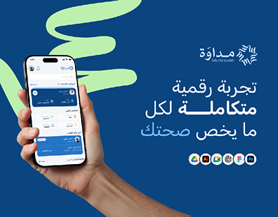

# Mudawah Arabic health app: hand holding a phone on navy with a mint brush swoosh

**Discipline:** app · **Design type:** Device mockup scene · **Design style:** Corporate & Clean-Tech
**Tags:** health, arabic, navy, mint, hand-mockup, tool-icons

## What it is
A navy cover with a big mint brush-stroke swoosh behind a hand holding a phone with an Arabic health dashboard, a large white-and-blue Arabic headline, the Mudawah logo and a row of design tool icons.

## What it means
Modern and reassuring; the energetic swoosh lifts a clinical navy palette.

## Techniques
- Add one loose brush swoosh behind the device.
- Highlight a key word in the headline in light blue.
- List the tools used as a small icon row.

## Best for
- Health app covers
- Arabic app launches
- Case study thumbnails

## Vocabulary
- **Brush swoosh** — A loose painted stroke used for energy.
- **Tool stack** — Icons of the software used in a project.
