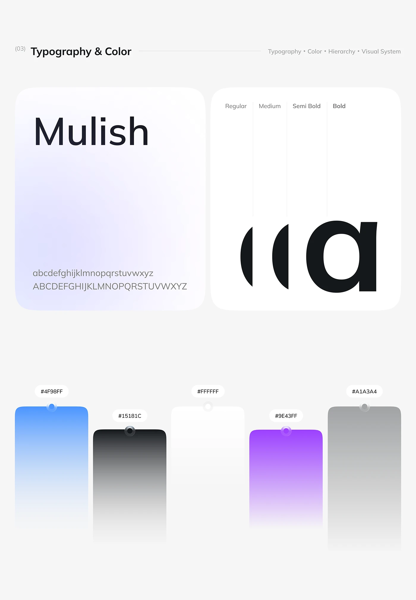

# Mulish Type and Gradient Palette Sheet

**Discipline:** app ·  · **Design style:** Gradient & Aurora
**Tags:** typography, palette, gradient, soft, blue, purple, design-system

## What it is
A design-system page with a large 'Mulish' specimen on a lavender card, a weight comparison showing a single 'a' revealed across four weights, and five tall gradient swatches with hex labels.

## What it means
Soft gradients and rounded cards keep the sheet gentle. The cropped weight reveal turns dry specs into a small visual moment.

## Techniques
- Slice one letter across weight columns to show progression
- Tall fading swatches with pin-like hex chips
- Soft lavender glow inside the specimen card
- Neutral off-white page around rounded cards
- Section numbering in parentheses

## Best for
- Design system documentation
- Brand guideline pages
- Type-and-colour presentations

## Vocabulary
- **Weight ramp** — A display of the same glyph in increasing weights.
- **Gradient swatch** — A colour sample shown fading to transparent.
- **Hex chip** — A small label giving a colour's hex code.
