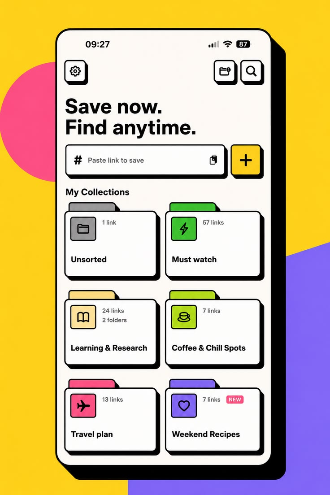

# Neo-Brutalist Link Saver App

**Discipline:** app ·  · **Design style:** Neo-Brutalist
**Tags:** neo-brutalism, yellow, pink, violet, black-outline, hard-shadow, collections, folders

## What it is
A phone with a thick black outline and hard offset shadow on a yellow background with a pink circle and violet block, showing 'Save now. Find anytime.' with a paste field and plus button and six folder cards each with a coloured tab and icon.

## What it means
Thick outlines, hard shadows and saturated flat colours feel playful and tactile, like paper stickers.

## Techniques
- Thick black outlines on every element
- Hard offset shadows instead of blur
- Folder-shaped cards with coloured tabs
- Saturated flat background shapes
- Bold heavy grotesque headline

## Best for
- Playful utility apps
- Neo-brutalist UI explorations
- Collection and folder interfaces

## Vocabulary
- **Neo-brutalism** — A style using thick outlines, hard shadows and flat saturated colour.
- **Hard shadow** — A solid offset shadow with no blur.
- **Folder tab** — A raised coloured tab on a card's top edge.
