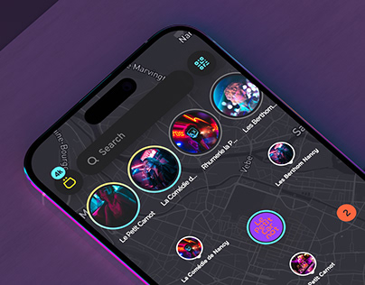

# Nightlife discovery map with circular story bubbles in neon

**Discipline:** app ·  · **Design style:** Dark & Neon
**Tags:** map, nightlife, dark-mode, neon, story-bubbles, purple, discovery, tilted-mockup

## What it is
A tilted phone on a purple surface shows a dark map covered by circular photo bubbles with coloured neon rings and venue names, a floating search pill, and small badges.

## What it means
Vibrant and social; venue photos sit on the map like stories, making discovery feel alive.

## Techniques
- Replace pins with circular photo avatars on the map.
- Ring each avatar in a neon gradient to show activity.
- Use a dark, muted map so imagery pops.
- Float a translucent search pill above the map.

## Best for
- Event, nightlife and local discovery apps
- Social maps
- Dark-themed consumer apps

## Vocabulary
- **Photo pin** — A map marker made of a circular photograph.
- **Story ring** — A coloured ring around an avatar signalling new content.
- **Dark map** — A low-contrast night-style base map.
- **Floating search** — A search field hovering above content.
