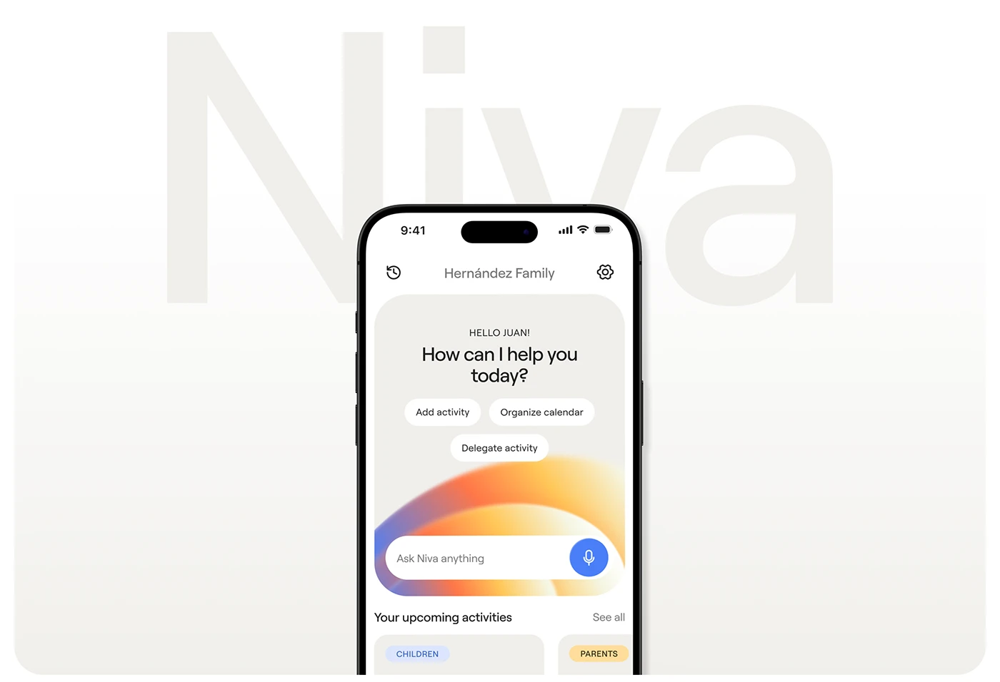

# Assistant home screen on a phone over a giant pale 'Niva' wordmark that fades into white

**Discipline:** app · **Design type:** Device mockup scene
**Tags:** assistant, ai, white, ghost-wordmark, gradient-arc, chips, project-cover, rounded

## What it is
A white rounded frame with a huge pale-grey 'Niva' fading downward behind a centred phone showing the family assistant screen: greeting, question, three action chips, a gradient arc and an Ask Niva input with a blue mic, plus upcoming activity cards at the base.

## What it means
Clean and calm; the ghost name gives brand presence without clutter.

## Techniques
- Set a faded giant name behind a phone.
- Fade the backdrop to white.
- Crop the phone at the bottom.
- Use a warm gradient arc as the AI glow.

## Best for
- Assistant app covers
- White minimal presentations
- Family and productivity apps

## Vocabulary
- **Ghost wordmark** — A giant faint brand name behind content.
- **Vertical fade** — A gradient fading toward white.
- **Action chip** — A small pill for a quick action.
- **Bottom crop** — A device cut by the frame's lower edge.
