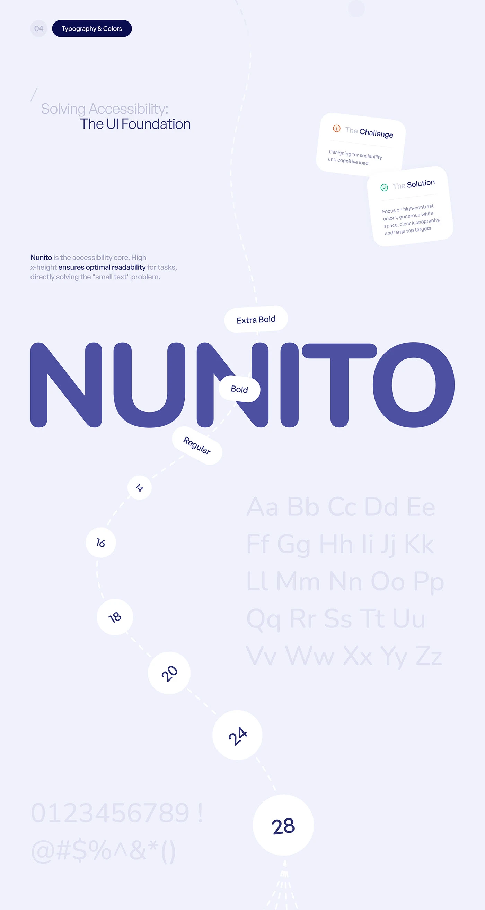

# Nunito Type Scale on a Curved Path

**Discipline:** app · **Design type:** Typography and colour guide
**Tags:** typography, nunito, type-scale, lavender, indigo, accessibility, tall

## What it is
A tall lavender sheet with a giant indigo 'NUNITO' wordmark, weight labels (Regular, Bold, Extra Bold) on pills, a curved dashed path of numbered circles from 14 to 28 showing the size scale, faint alphabet and numerals, and challenge/solution cards.

## What it means
Turning a type scale into a curved journey makes documentation playful, while the enormous rounded letters show off the typeface's friendliness.

## Techniques
- Type scale plotted as a path of growing circles
- Weight names pinned to the word as floating pills
- Alphabet and numerals ghosted in the background
- Gigantic specimen in a single accent colour
- Tilted challenge and solution cards

## Best for
- Design-system typography pages
- Accessibility rationale slides
- Long-scroll brand documentation

## Vocabulary
- **Type scale** — A set of sizes used in an interface, such as 14, 16, 18, 20.
- **Specimen** — A showcase of a typeface's forms.
- **Weight pill** — A small label naming a typeface weight.
