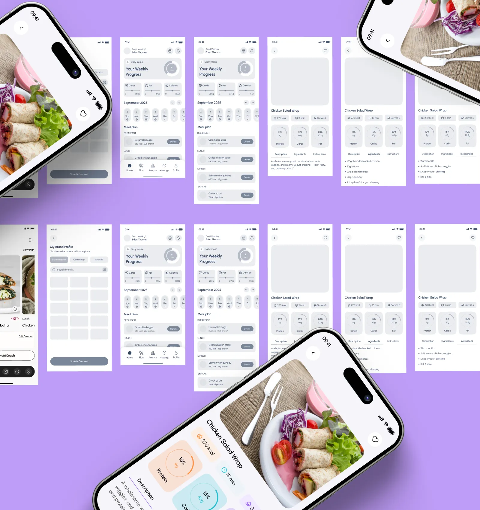

# Grey wireframe screens for a meal-planning app with two tilted photo-rich phones on lilac

**Discipline:** app · **Design type:** Wireframe showcase
**Tags:** wireframes, nutrition, lilac, grey, tilted-phones, meal-plan, flow, photography

## What it is
A lilac board with a grid of pale grey wireframe screens (weekly progress, meal plan, recipe detail with macros) and three oversized tilted phones showing the finished recipe screen with a wrap photo, pastel macro rings and orange kcal.

## What it means
Clear about process; tilted finished screens burst out of the grey wireframes.

## Techniques
- Show grey wireframes as the base grid.
- Break out with oversized tilted high-fidelity phones.
- Use pastel ring charts for macros.
- Keep the background a single lilac.

## Best for
- Wireframe-to-final case studies
- Food and health apps
- UX process boards

## Vocabulary
- **Lo-fi to hi-fi** — Showing wireframes beside finished designs.
- **Macro ring** — A ring chart of protein, carbs or fat.
- **Breakout mockup** — A phone oversized and tilted out of a grid.
- **Wireframe grid** — A layout of grey structural screens.
