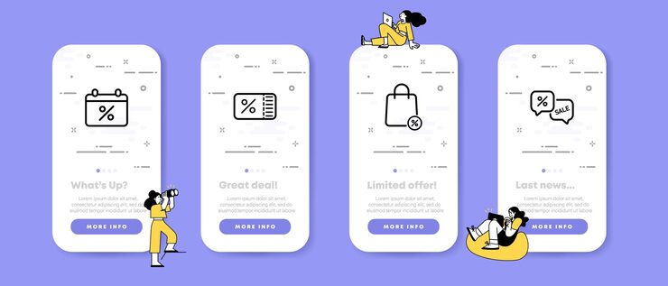

# Lilac onboarding screens with line-icon discount illustrations

**Discipline:** app · **Design type:** Onboarding screens · **Design style:** Playful & Illustrated
**Tags:** onboarding, app screens, line icons, lilac, discount, illustration

## What it is
Four phone onboarding screens on a lilac background, each pairing a bold outline icon (calendar, list, bag, chat) with a small illustrated character and a 'More Info' button.

## What it means
Consistent bold-line iconography plus one recurring character keeps each onboarding step visually tied together while each screen still communicates a distinct benefit.

## Techniques
- pair a big centered line icon with a small supporting character illustration per screen
- hold one flat background color across the whole onboarding flow for cohesion
- repeat an identical CTA button style/position across screens to build a predictable rhythm

## Best for
- shopping or deals app onboarding
- fintech/coupon app first-run flows
- illustrated app walkthrough kits

## Vocabulary
- **onboarding flow** — the sequence of introductory screens shown to a first-time app user to explain key features
