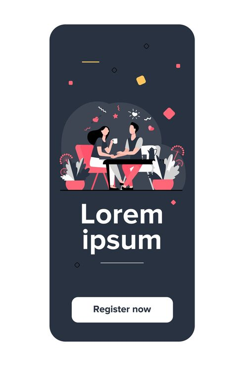

# Dark app splash screen with flat couple illustration

**Discipline:** app · **Design type:** Onboarding screens · **Design style:** Playful & Illustrated
**Tags:** splash screen, app screen, flat illustration, dark, couple, confetti

## What it is
A single dark-background phone splash/registration screen, featuring a flat illustration of a couple at a café table surrounded by small confetti shapes, with a 'Lorem ipsum' headline and a 'Register now' pill button.

## What it means
A warm illustrated scene against an otherwise dark UI screen softens what could feel like a cold registration prompt, making the sign-up moment feel inviting rather than transactional.

## Techniques
- center a warm illustrated scene within an otherwise dark, minimal UI screen for contrast
- scatter small confetti/celebration shapes around the illustration to add lightness without clutter
- use a single full-width pill button as the only interactive element for a focused call to action

## Best for
- dating/social app registration screens
- dark-mode consumer app onboarding
- illustrated splash screen templates

## Vocabulary
- **splash screen** — a brief introductory screen shown while an app loads or before a key action like registration
