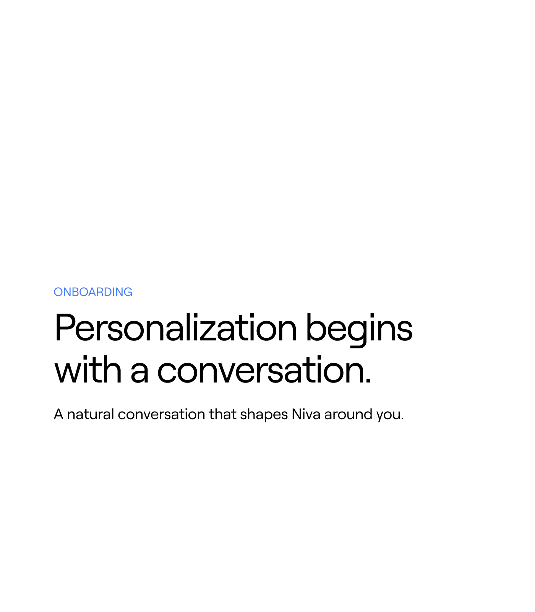

# White slide with a blue 'ONBOARDING' eyebrow and a large black 'Personalization begins with a conversation.'

**Discipline:** app · **Design type:** Case study intro slide
**Tags:** case-study, white, statement, blue-eyebrow, minimal, large-type, section-title

## What it is
An almost empty white slide with a blue caps label 'ONBOARDING', a large black two-line sans statement and a smaller subline about a natural conversation shaping Niva.

## What it means
Confident and quiet; big words on white introduce a chapter.

## Techniques
- Use a coloured eyebrow label.
- Set a big two-line statement.
- Add a small line of support.
- Leave most of the slide empty.

## Best for
- Case-study chapter openers
- Minimal white decks
- Statement slides

## Vocabulary
- **Eyebrow label** — A small coloured caps line above a title.
- **Chapter opener** — A slide introducing a new section.
- **Support line** — A short line under a statement.
- **White space** — Empty space used for emphasis.
