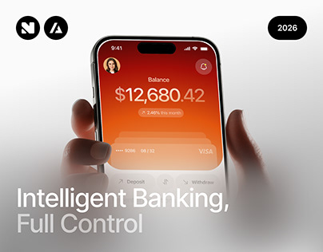

# Orange Balance Screen in Blurred Hands

**Discipline:** app · **Design type:** Device mockup scene
**Tags:** orange, banking, hands, blur, balance, card, cover

## What it is
A cover with a phone showing an orange-red gradient balance screen ($12,680.42) and stacked cards, held by hands softly blurred in front, with a two-tone headline 'Intelligent Banking, Full Control' and a year tag.

## What it means
The blurred foreground hands create depth and intimacy, and the hot orange screen draws the eye against white.

## Techniques
- Foreground hands out of focus for depth of field
- White fade rising from the bottom to hold headline text
- Two-tone headline with the second phrase dimmed
- Round logo chips and year pill at the top
- Card stack peeking below the balance

## Best for
- Banking app covers
- Case-study intros
- Hero images with a text zone

## Vocabulary
- **Foreground blur** — Blurring near objects to focus on the main subject.
- **Text zone** — An area kept clear to place a headline.
- **Card stack** — Overlapping cards suggesting multiple accounts.
