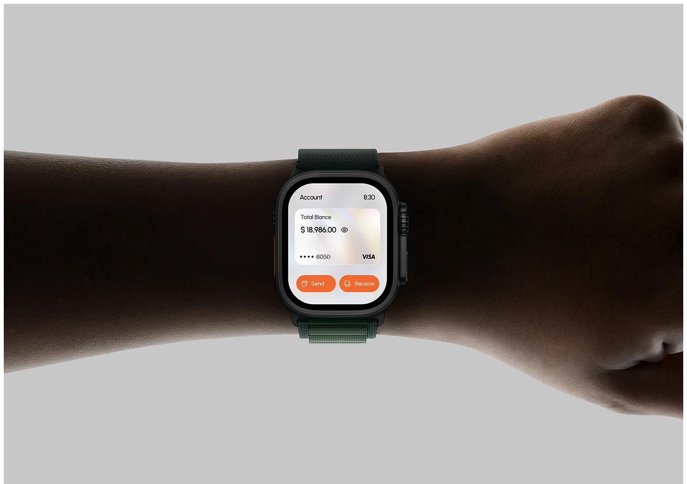

# Orange Banking Watch on a Dark Wrist

**Discipline:** app · **Design type:** Wearable UI
**Tags:** smartwatch, banking, wrist, orange, grey, silhouette, balance

## What it is
A pale grey backdrop with a dark forearm in silhouette crossing the frame and a smartwatch on the wrist showing a bank card balance with orange Send and Receive buttons.

## What it means
The dark arm against a light field makes the small bright screen the only focal point, showing how little UI a watch needs.

## Techniques
- Silhouetted arm across the frame for drama
- Small screen lit and highly legible
- Orange as the sole action colour
- Simple card-and-two-buttons layout
- Minimal light-grey backdrop

## Best for
- Wearable banking and payment concepts
- Product hero shots on a body
- Minimal glanceable UI

## Vocabulary
- **Silhouette** — A subject rendered as a dark shape against light.
- **Glance layout** — A UI with one key number and few actions.
- **Wrist shot** — A photo of a wearable in use.
