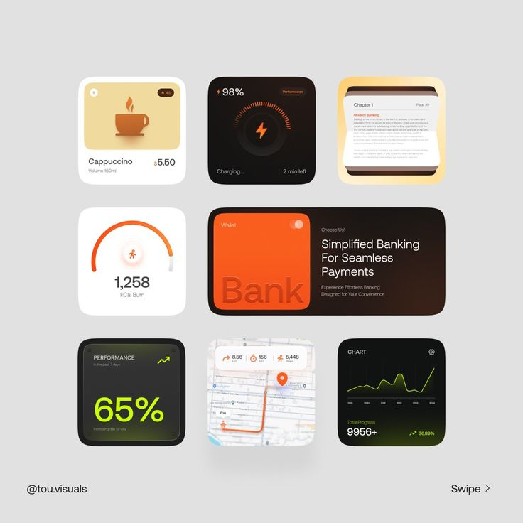

# Orange, Black and Cream Widget Tile Set

**Discipline:** app ·  · **Design style:** Geometric & Bauhaus
**Tags:** widgets, tiles, orange, black, cream, lime, carousel, rounded-squares

## What it is
A pale grey board with a 3-by-3 grid of rounded widget tiles: a cappuccino product card, a charging gauge, a book page, a calorie burn gauge, a wide orange Bank wallet card with a headline, a lime 65% performance tile, a map route tile and a line chart tile, with a handle and swipe cue.

## What it means
A mixed set of squares in orange, black and cream with a lime pop shows a versatile widget system in one language.

## Techniques
- Rounded-square tiles of varied content
- Orange as the leading accent
- Lime used once for a performance tile
- One wide tile spanning two columns
- 3D and embossed touches on icons and lettering

## Best for
- Widget and card component showcases
- Carousel-format design posts
- Multi-purpose tile systems

## Vocabulary
- **Widget tile** — A small rounded square showing one piece of information.
- **Embossed lettering** — Text that looks pressed into or raised from a surface.
- **Swipe cue** — A small prompt for the next carousel slide.
