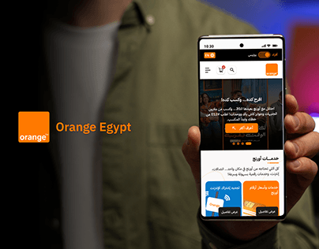

# Orange Egypt mobile redesign: a hand holding a phone beside the orange square logo on black

**Discipline:** app · **Design type:** Device mockup scene · **Design style:** Photographic & Cinematic
**Tags:** telecom, orange, black, hand-mockup, arabic, redesign

## What it is
A dark cover with a blurred person holding a phone showing the Orange Egypt Arabic mobile site (hero banner, services cards), the orange square logo and 'Orange Egypt' in white on the left.

## What it means
Real and brand-true; the in-hand photo and the orange square make it feel native to the brand.

## Techniques
- Use a real hand-held phone photo.
- Place the brand's logo square as the only colour.
- Blur the person so the screen leads.

## Best for
- Telecom redesigns
- Brand-led app covers
- Mobile web case studies

## Vocabulary
- **Hand mockup** — A photo of a device held in a hand.
- **Brand square** — A logo presented as a solid colour block.
