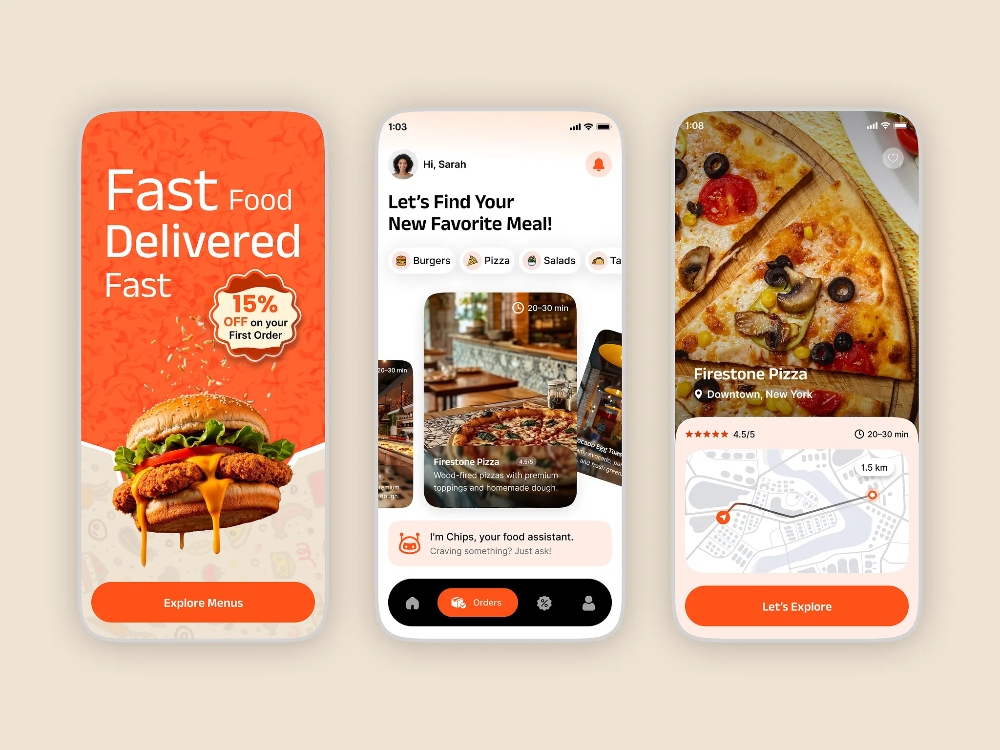

# Orange food delivery app: burger splash, restaurant carousel with assistant chip and map detail

**Discipline:** app · **Design type:** Food ordering app
**Tags:** food, delivery, orange, cream, cutout, assistant, map, pill-nav

## What it is
Three phones on beige: an orange onboarding with a cut-out cheeseburger, a scalloped '15% OFF' badge and pill CTA; a home with category chips, tilted restaurant cards and a 'Chips' assistant strip above a black pill nav with an orange active tab; and a pizza detail with rating, time and a route map.

## What it means
Appetising and friendly; orange and photography make hunger tangible.

## Techniques
- Cut out the hero food over a patterned orange panel.
- Use a scalloped badge for the offer.
- Tilt side cards in a carousel.
- Add an assistant strip in a tinted pill.

## Best for
- Food delivery apps
- Orange brands
- Onboarding with product cutouts

## Vocabulary
- **Scalloped badge** — A badge with wavy edges.
- **Assistant strip** — A tinted bar introducing an AI helper.
- **Tilted carousel** — Cards rotated at the sides.
- **Route map card** — A map with a path in a bottom sheet.
