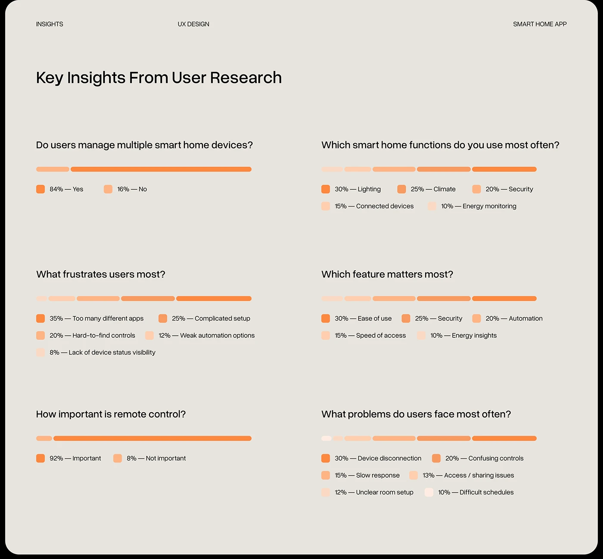

# Orange Segmented Bars Survey Insights

**Discipline:** app ·  · **Design style:** Warm & Organic
**Tags:** research, survey, orange, segmented-bars, beige, questions, legend

## What it is
A warm beige rounded slide titled Key Insights From User Research with six survey questions each above a single pill bar split into orange tints, and a legend of percentages and answers below each.

## What it means
One hue in graded tints turns survey results into an easy-to-scan ramp, and repeated structure makes six questions feel calm.

## Techniques
- Single horizontal segmented bar per question
- One orange in five graded tints
- Legend chips with percentage and label
- Question headings in plain sans
- Header labels in the corners

## Best for
- Survey result slides
- Smart-home and product research
- Single-colour data presentation

## Vocabulary
- **Segmented bar** — A bar split into parts proportional to answers.
- **Tonal ramp** — Tints of one hue from dark to light.
- **Legend chip** — A small coloured square with a value and label.
