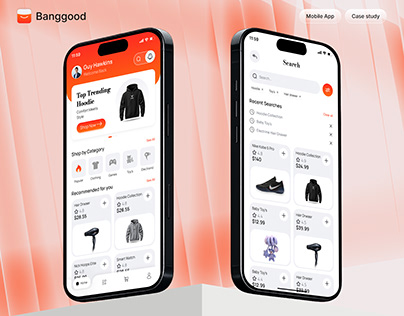

# Orange Marketplace Phones on Ribbed Backdrop

**Discipline:** app ·  · **Design style:** 3D & Surreal
**Tags:** orange, marketplace, two-phones, ribbed, podium, shopping

## What it is
Two black-framed phones showing an orange and white shopping home and search screen, standing before a peach ribbed panel backdrop with a white block at the base and a logo at top left.

## What it means
Orange gradients and vertical ribs feel warm and energetic, and the two screens show home and search together.

## Techniques
- Ribbed vertical texture behind the phones
- Gradient orange banner as hero card
- Two screens at slightly different heights
- White plinth at the bottom
- Product cut-outs in a clean grid

## Best for
- Shopping app presentations
- Two-screen hero mockups
- Warm-toned brands

## Vocabulary
- **Ribbed backdrop** — A vertically fluted surface used as a scene background.
- **Plinth** — A block used as a display base.
- **Paired screens** — Two related screens shown side by side.
