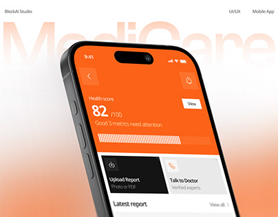

# Orange Medical App Health Score with Ghost Title

**Discipline:** app · **Design type:** Device mockup scene
**Tags:** medical, orange, ghost-type, health-score, peach, cover, cards

## What it is
A white and peach cover with a giant faint 'MediCare' behind a tilted phone with an orange health score screen (82/100), a segmented progress bar and black and grey action cards, and studio, discipline and platform labels at the top.

## What it means
Orange gives a medical app energy and warmth, and the score screen tells the story at a glance.

## Techniques
- Solid orange screen as the hero colour
- Segmented bar as score progress
- Black and grey action tiles for contrast
- Ghost name and peach glow behind
- Tiny top labels naming studio and format

## Best for
- Medical and health-score apps
- Bold single-colour UI covers
- Peach gradient covers

## Vocabulary
- **Health score** — A single number summarising overall health status.
- **Segmented progress** — A bar made of small blocks that fill in.
- **Top labels** — Small captions across the top of a cover.
