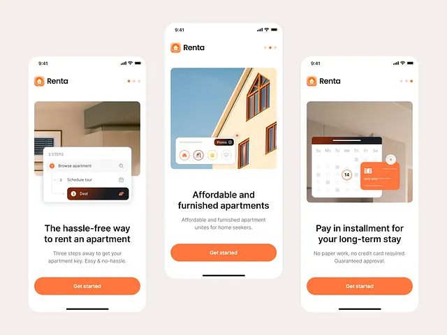

# Apartment-rental onboarding on white with orange buttons, room photos and floating UI cards

**Discipline:** app ·  · **Design style:** Playful & Illustrated
**Tags:** onboarding, rental, orange, white, photo, floating-cards, dots, three-screens

## What it is
Three phones on blush: each with an orange logo, step dots, a room photo with an overlay UI (steps list, promo chips, calendar with an orange card), a bold headline, a grey line and a full-width orange 'Get started' button.

## What it means
Friendly and clear; UI overlays on photos explain features in context.

## Techniques
- Overlay a small UI card on a photo.
- Use a single orange button.
- Show a step list in the card.
- Use page dots at top.

## Best for
- Rental and proptech onboarding
- Photo-plus-UI screens
- Orange-brand apps

## Vocabulary
- **UI overlay on photo** — An interface card placed over an image.
- **Step dots** — Dots showing onboarding position.
- **Orange CTA** — A full-width orange button.
- **Feature illustration** — An image explaining one feature.
