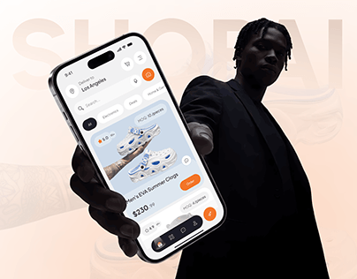

# Orange Shopping App Held by a Figure

**Discipline:** app ·  · **Design style:** Gradient & Aurora
**Tags:** shopping, orange, peach, silhouette, ghost-type, hand, cover

## What it is
A peach gradient cover with giant faint 'Shopai' lettering, a phone held outstretched by a person in a black coat toward the viewer showing an orange shopping home with a sneaker card.

## What it means
The reaching arm invites the viewer in, and the black clothing makes the orange UI glow.

## Techniques
- Person offering the phone toward the camera
- Black clothing against a peach backdrop
- Orange as the UI and accent colour
- Ghost brand name behind the figure
- Tilted phone in the foreground

## Best for
- Shopping app covers
- Fashion and e-commerce apps
- Human-led hero images

## Vocabulary
- **Offered device** — A phone held out toward the viewer.
- **Ghost brand name** — Faint oversized brand text behind a subject.
- **Peach gradient** — A soft pink-orange colour blend.
