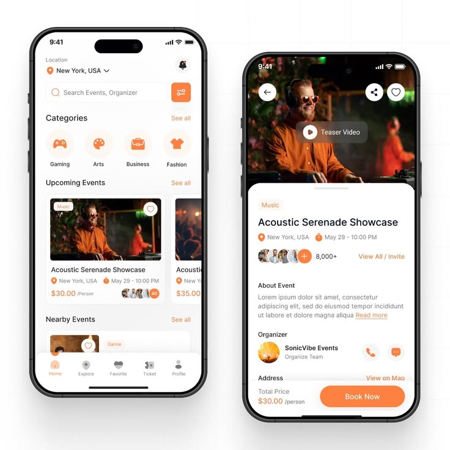

# Orange Events App Home and Detail

**Discipline:** app · **Design type:** E-commerce app
**Tags:** events, orange, white, photos, tickets, two-phones, categories

## What it is
Two white phones with orange accents: a home with location, search, category circles and event cards with photos, and an event detail with a hero photo, teaser video button, attendee avatars, organizer and a big Book Now bar.

## What it means
Orange on white feels lively and social, and warm event photos carry the mood.

## Techniques
- Orange for icons, tags and the main button
- Circular category icons in pale orange
- Hero photo with overlaid teaser video pill
- Attendee avatar stack with a plus count
- Sticky bottom bar with price and CTA

## Best for
- Event and ticketing apps
- Light UI with a warm accent
- Discovery and detail screens

## Vocabulary
- **Category circle** — A round icon button for a content category.
- **Avatar stack** — Overlapping avatars showing attendees.
- **Sticky CTA bar** — A bottom bar with price and action that stays visible.
