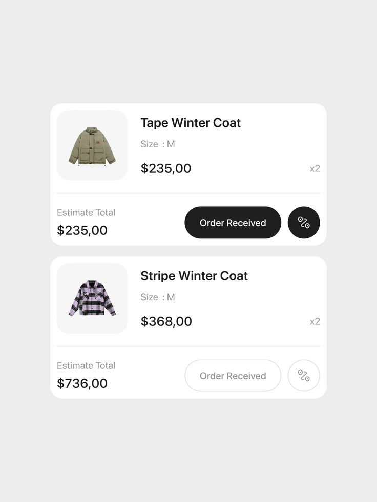

# Order Cards with Primary and Ghost Buttons

**Discipline:** app ·  · **Design style:** Minimalist
**Tags:** order, cards, white, black-button, ghost-button, fashion, states

## What it is
Two white order cards on light grey showing a winter coat with size, price and quantity, an estimated total, and an 'Order Received' pill in solid black on the first and outlined grey on the second, plus a circular icon button.

## What it means
The pair demonstrates active and inactive button states clearly, and clean typography keeps it calm.

## Techniques
- Solid versus ghost button to show state
- Thumbnail on a pale rounded tile
- Divider line separating summary from actions
- Muted grey secondary text
- Circular icon button beside the pill

## Best for
- E-commerce order lists
- Component state demos
- Minimal app UI

## Vocabulary
- **Ghost button** — A button with only an outline.
- **Order card** — A card summarising one order item.
- **State pair** — Two versions of one component in different states.
