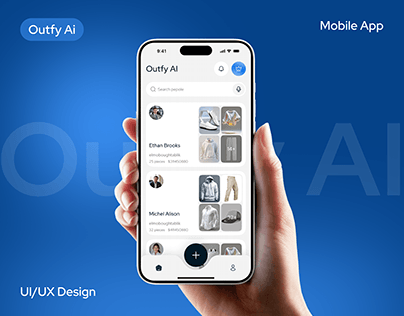

# Outfit App in Hand on Cobalt Blue

**Discipline:** app ·  · **Design style:** Minimalist
**Tags:** cobalt, blue, hand, ghost-type, fashion, cover, white-ui

## What it is
A saturated blue cover with giant faint 'Outfy AI' letters, a hand holding a white phone showing a wardrobe app with outfit cards, and 'Mobile App' and 'UI/UX Design' labels in the corners.

## What it means
A pure blue field makes a white UI pop, and the hand adds a human scale.

## Techniques
- Ghost title behind the phone
- Solid cobalt background
- Hand entering from the bottom
- Corner labels for format and discipline
- Simple white UI with photo cards

## Best for
- Fashion and wardrobe apps
- Bold single-colour covers
- Simple hand-held mockups

## Vocabulary
- **Cobalt field** — A strong saturated blue used as a flat background.
- **Outfit card** — A card showing a set of clothing items.
- **Corner labels** — Small captions in the corners of a cover.
