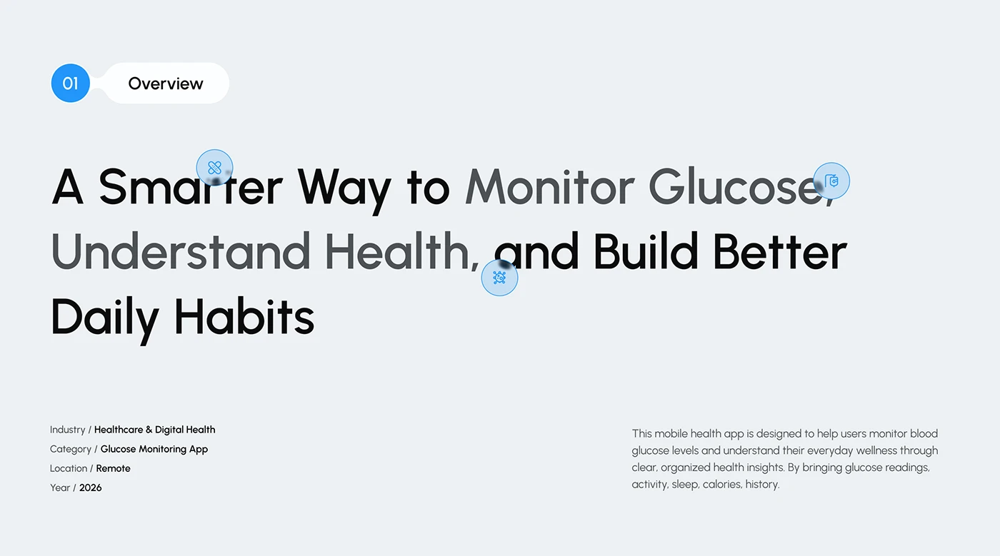

# Overview Slide with Icon-Studded Headline

**Discipline:** app ·  · **Design style:** Corporate & Clean-Tech
**Tags:** overview, headline, metadata, grey, icons, blue, two-tone

## What it is
A pale grey slide with a numbered 'Overview' pill, a huge headline whose phrases alternate black and grey with blue icon bubbles, and key-value metadata at the bottom left with a paragraph at the right.

## What it means
Alternating tones and icon bubbles make a long headline scannable and lively.

## Techniques
- Alternate dark and mid grey phrases in the headline
- Small blue icon bubbles dotted over the text
- Number bubble joined to a title pill
- Slash-style key/value metadata
- Paragraph right-aligned in a second column

## Best for
- Project overview slides
- Health-tech case studies
- Headline-led slides

## Vocabulary
- **Icon bubble** — A small circular icon placed over or beside text.
- **Number pill** — A numbered circle joined to a label.
- **Key/value list** — Label and value pairs in compact lines.
