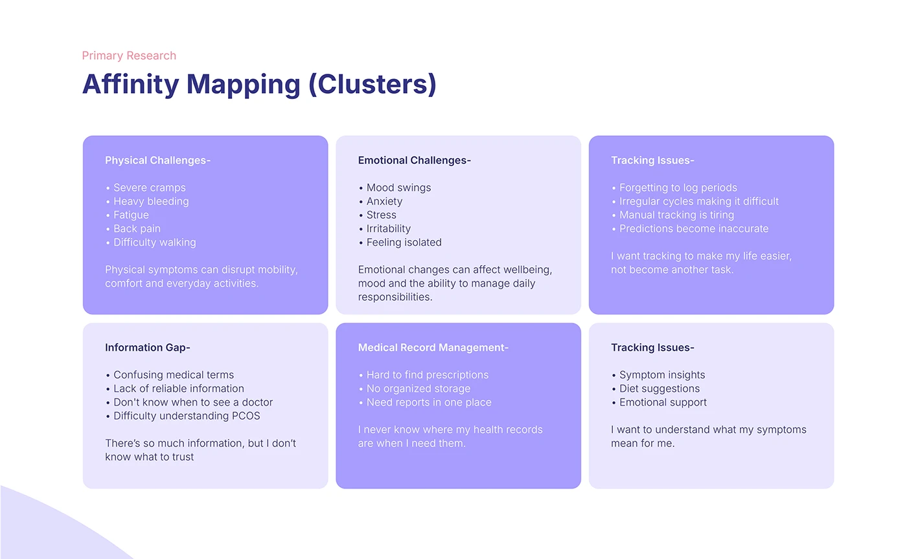

# OVIAH affinity mapping: six themed lilac clusters grouping research findings into insight statements

**Discipline:** app · **Design type:** UX documentation · **Design style:** Minimalist
**Tags:** affinity-mapping, ux-research, clusters, lilac, synthesis

## What it is
A 3x2 grid of alternating light and mid-lilac cards titled 'Affinity Mapping (Clusters)': Physical Challenges, Emotional Challenges, Tracking Issues, Information Gap, Medical Record Management and a second Tracking Issues cluster, each listing bullet findings and closing with an italic synthesised insight quote.

## What it means
Synthesised and traceable; grouping raw findings into named clusters shows how research became design direction.

## Techniques
- Cluster raw findings under named themes.
- Close each cluster with a synthesised first-person insight.
- Alternate card tints to distinguish adjacent clusters.

## Best for
- Affinity mapping documentation
- Research synthesis slides
- UX process decks

## Vocabulary
- **Affinity mapping** — Grouping research data into themes based on natural relationships.
- **Synthesis statement** — A summarising insight drawn from grouped data.
