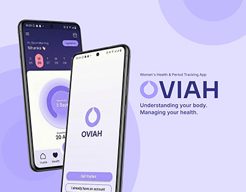

# OVIAH case study cover: two phones over lilac blob shapes with a droplet-O logo

**Discipline:** app · **Design type:** Case study cover · **Design style:** Minimalist
**Tags:** case-study-cover, health, period-tracking, lilac, logo, hero

## What it is
A lavender cover with soft overlapping circle blobs, two phones showing a home screen with a cycle countdown ring and an onboarding welcome screen with a droplet-shaped 'O' logo, and 'OVIAH — Understanding your body. Managing your health.' beside them.

## What it means
Calm and reassuring; soft blobs and a droplet logo make a health topic feel gentle rather than clinical.

## Techniques
- Use a droplet or organic shape as a wordmark's first letter.
- Show a countdown ring as the home screen's focal metric.
- Layer soft overlapping blobs for a calm backdrop.

## Best for
- Health and wellness app covers
- Period-tracking apps
- Case study title slides

## Vocabulary
- **Countdown ring** — A circular progress indicator counting down to an event.
- **Droplet logo** — A logo shaped like a water drop, often used for health or fluid themes.
