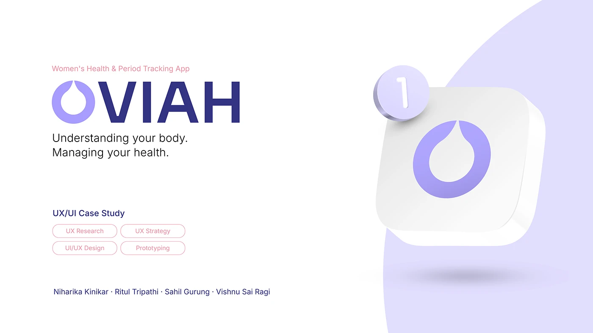

# OVIAH case study title slide: wordmark, category tags and full team credit line beside a glossy 3D app icon

**Discipline:** app · **Design type:** Case study cover · **Design style:** Minimalist
**Tags:** case-study-cover, title-slide, tags, credits, lilac

## What it is
A white cover with 'Women's Health & Period Tracking App' eyebrow, the large OVIAH wordmark, tagline, a 'UX/UI Case Study' label with four pink-outlined tag pills (UX Research, UX Strategy, UI/UX Design, Prototyping), a full team credit line, and the same glossy 3D app-icon tile with badge on the right.

## What it means
Professional and scannable; tag pills let a viewer instantly see the case study's scope before reading further.

## Techniques
- List a case study's discipline scope as tag pills.
- Credit the full team on the opening slide, not just the close.
- Bookend a case study with the same 3D icon tile at start and end.

## Best for
- Case study title slides
- Portfolio project covers
- UX case study openers

## Vocabulary
- **Tag pill** — A small rounded label naming one category or skill.
- **Bookending** — Repeating a visual element at both the start and end of a piece.
