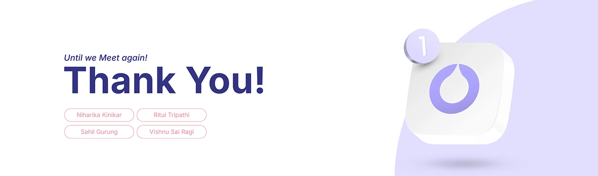

# OVIAH closing 'Until we Meet again! Thank You!' slide with team-name pills and a glossy 3D app icon tile

**Discipline:** app · **Design type:** Case study closing slide · **Design style:** Minimalist
**Tags:** closing-slide, thank-you, 3d-icon, lilac, credits

## What it is
A white slide with an italic 'Until we Meet again!' eyebrow, a huge navy 'Thank You!', four pink-outlined pills naming the team members, and on the right a glossy white 3D app-icon tile with the droplet logo and a small numbered badge, set against a purple blob.

## What it means
Warm and polished; the glossy icon tile turns a simple thank-you into a final piece of brand presentation.

## Techniques
- Render the app icon as a glossy 3D tile for the closing slide.
- List team members as individual pills rather than one line.
- Keep the closing tone personal with a light, informal eyebrow line.

## Best for
- Case study closing slides
- Team credits
- Portfolio endings

## Vocabulary
- **3D icon tile** — An app icon rendered with depth and shading like a physical object.
- **Eyebrow text** — A small line of text above a main headline.
