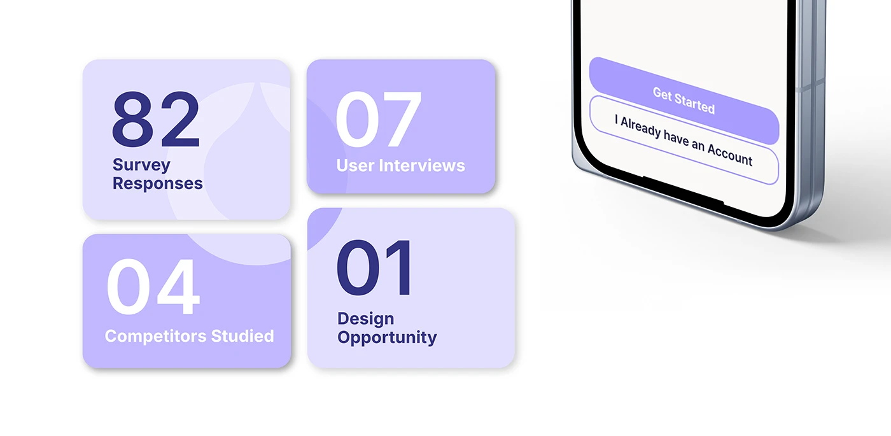

# OVIAH 'Visual Language of the app': five core colours each expanded into five tints and five shades

**Discipline:** app · **Design type:** Typography and colour guide · **Design style:** Minimalist
**Tags:** colour-palette, tints-and-shades, hex-codes, lilac, design-system

## What it is
A slide with five large colour swatches (off-white #faf9f7, lilac #9890e7, navy #1f1e50, pale pink #f3dde1, coral pink #f192a3) each labelled with its hex code, and beneath each a small card showing five lighter tints and five darker shades with percentage labels.

## What it means
Scalable and precise; expanding each core colour into a full ramp equips every future UI state with the right shade.

## Techniques
- Pair each core colour with its full tint and shade ramp.
- Label tints and shades by percentage for exact reproduction.
- Name the overall system 'visual language' to frame it as more than just colours.

## Best for
- Colour system documentation
- Design token libraries
- Brand palette guides

## Vocabulary
- **Tint** — A colour mixed with white, making it lighter.
- **Shade** — A colour mixed with black, making it darker.
