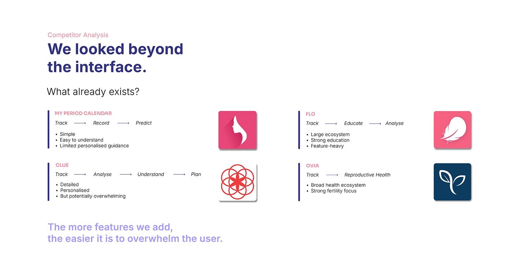

# OVIAH competitor analysis: four period-app flows compared as arrow-linked step chains with logos

**Discipline:** app · **Design type:** UX documentation · **Design style:** Minimalist
**Tags:** competitor-analysis, ux-research, health, lilac, comparison

## What it is
A white slide titled 'We looked beyond the interface. What already exists?' with four competitor cards (My Period Calendar, Flo, Clue, Ovia), each showing its core flow as arrow-linked steps (Track → Record → Predict) with bullet pros/cons and the app's logo, closing with 'The more features we add, the easier it is to overwhelm the user.'

## What it means
Analytical and honest; reducing each competitor to one flow line makes differences instantly comparable.

## Techniques
- Reduce each competitor to a single arrow-linked flow.
- Pair pros and cons as short bullets under each flow.
- End competitive analysis with a stated design principle.

## Best for
- Competitor analysis slides
- UX research documentation
- Market positioning

## Vocabulary
- **Flow chain** — A sequence of steps linked by arrows.
- **Design principle** — A guiding statement derived from research.
