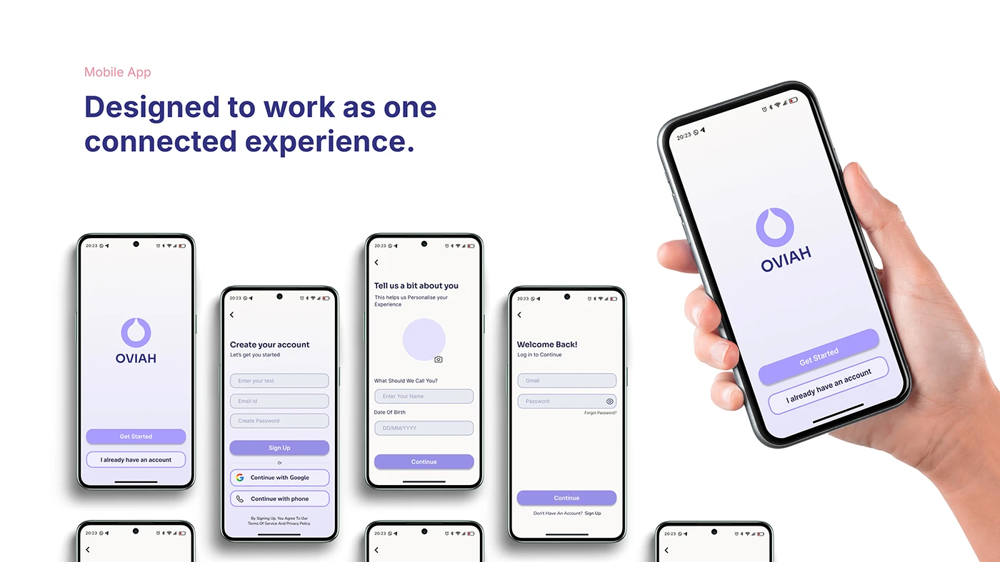

# OVIAH 'Designed to work as one connected experience' with a fanned row of onboarding screens and a hand-held hero

**Discipline:** app · **Design type:** Case study slide · **Design style:** Minimalist
**Tags:** onboarding, hand-mockup, lilac, case-study, consistency

## What it is
A white slide with the statement heading, a row of six onboarding phone screens (splash, create account, personalise, welcome-back login) fanned in a line, and a large hand holding a phone showing the splash screen and 'Get Started' buttons at the right.

## What it means
Cohesive and confident; the fanned row argues that every screen shares one visual language.

## Techniques
- Fan a sequence of screens in a single row to show consistency.
- Pair a summary statement with a hand-held hero device.
- Repeat the same button and card styling across all screens shown.

## Best for
- Design consistency slides
- Onboarding overviews
- Case study cohesion proof

## Vocabulary
- **Fanned row** — Screens arranged side by side to show sequence or variety.
- **Connected experience** — A product where every screen feels part of one coherent system.
