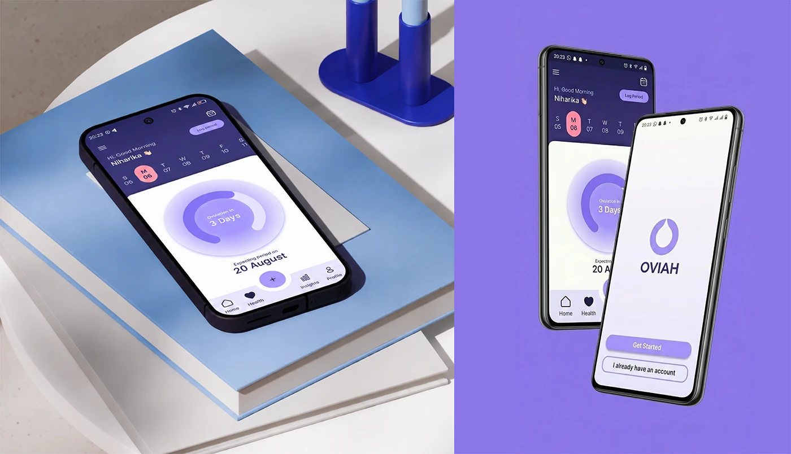

# OVIAH home dashboard staged on stacked books beside onboarding screens on a solid violet backdrop

**Discipline:** app · **Design type:** Device mockup scene · **Design style:** Minimalist
**Tags:** mockup, dashboard, violet, books, onboarding, phone-mockup

## What it is
Two mockup scenes: the home dashboard phone lying flat on a stack of blue books beside abstract blue cylinder props, and two phones on solid violet — the dashboard tilted behind a foreground splash screen with 'Get Started' and 'I already have an account' buttons.

## What it means
Versatile and polished; pairing a styled prop scene with a clean colour-block scene shows the design works in varied presentation contexts.

## Techniques
- Stage a phone flat among unrelated props for an editorial mood.
- Use a solid brand-colour backdrop for a cleaner alternative shot.
- Overlap two phones at different depths for a sense of flow.

## Best for
- App store screenshots
- Portfolio mockup variety
- Dashboard and onboarding pairing

## Vocabulary
- **Prop styling** — Arranging unrelated objects around a product for mood.
- **Colour-block backdrop** — A flat single-colour background behind a mockup.
