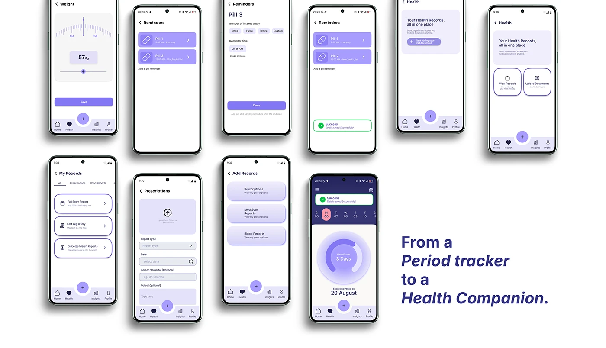

# OVIAH closing statement 'From a Period tracker to a Health Companion' beside a fan of health-record screens

**Discipline:** app · **Design type:** Case study closing slide · **Design style:** Minimalist
**Tags:** closing-slide, health-records, lilac, reminders, case-study

## What it is
A fanned row of ten phone screens (weight logging, pill reminders with success states, a health hub with view/upload actions, a records list, a prescription form with report type, and the home dashboard) beside the italic closing statement 'From a Period tracker to a Health Companion.'

## What it means
Ambitious and conclusive; the closing line reframes the whole case study as evolving beyond its original brief.

## Techniques
- Close with a statement that reframes the product's scope.
- Fan the broadest range of screens as final proof of depth.
- Mix serif-weight emphasis for a memorable closing line.

## Best for
- Case study conclusions
- Product vision statements
- Portfolio closing slides

## Vocabulary
- **Reframing statement** — A closing line that repositions what the product really is.
- **Screen fan** — Multiple screens arranged in an overlapping row.
