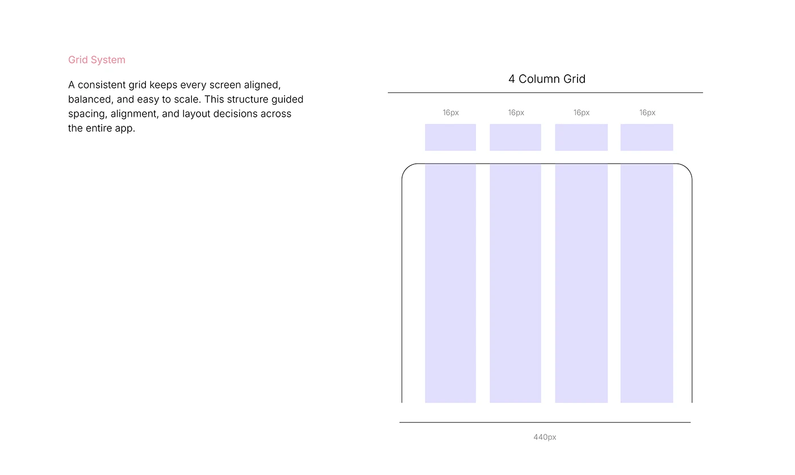

# OVIAH grid system: a labelled 4-column, 16px-gutter phone grid diagram with a rationale note

**Discipline:** app · **Design type:** Design system documentation · **Design style:** Minimalist
**Tags:** design-system, grid, lilac, documentation, layout

## What it is
A white slide with a short rationale paragraph on the left and, on the right, a diagram of a rounded phone frame divided into four lilac columns each 16px apart, labelled '4 Column Grid' and '440px' for the total width.

## What it means
Rigorous and reusable; documenting the exact grid keeps every future screen consistent without guesswork.

## Techniques
- Diagram a layout grid with exact pixel measurements.
- Explain the grid's purpose in one short paragraph.
- Show the grid overlaid on the actual device frame shape.

## Best for
- Design system documentation
- Layout grid specs
- Handoff-ready UX files

## Vocabulary
- **Gutter** — The fixed space between grid columns.
- **Layout grid** — An invisible structure of columns guiding alignment.
