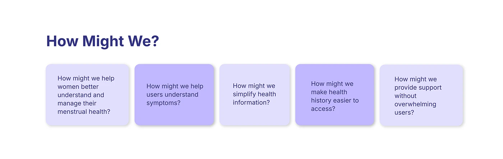

# OVIAH 'How Might We?' ideation slide: five lilac question cards alternating in shade

**Discipline:** app · **Design type:** UX documentation · **Design style:** Minimalist
**Tags:** ideation, how-might-we, ux-research, lilac, cards

## What it is
A simple white slide with a bold 'How Might We?' heading and five rounded cards in alternating light and mid lilac, each posing one design question ('How might we help women better understand and manage their menstrual health?', 'How might we simplify health information?').

## What it means
Focused and generative; alternating card shades keeps five similar questions visually distinct and scannable.

## Techniques
- Alternate two tints across a row of similar cards.
- Phrase each card as an open 'How might we' question.
- Keep card copy short enough to read at a glance.

## Best for
- Ideation and workshop slides
- Design thinking documentation
- UX process decks

## Vocabulary
- **How Might We** — A design-thinking technique for reframing problems as questions.
- **Tint alternation** — Switching between light and darker shades of one colour.
