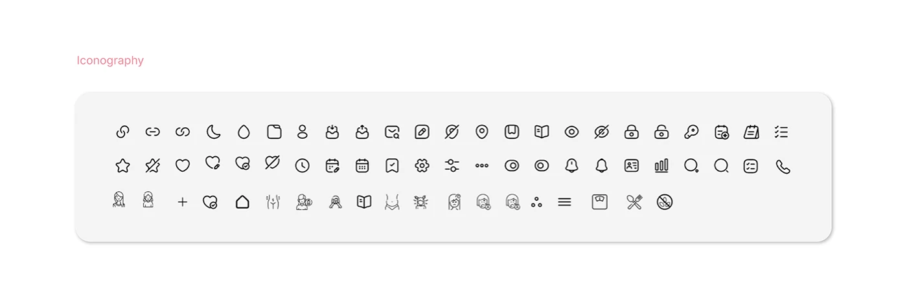

# OVIAH iconography sheet: a full set of thin outline icons for health tracking on a grey rounded panel

**Discipline:** app · **Design type:** Design system documentation · **Design style:** Minimalist
**Tags:** iconography, icon-set, outline-icons, lilac, design-system

## What it is
A grey rounded panel holding roughly 50 thin-stroke outline icons in three rows, covering navigation (link, moon, calendar), health symbols (droplet, heart, no-symbol), actions (edit, lock, search), and body/lifestyle icons (person, food, exercise), all in one consistent line weight.

## What it means
Cohesive and legible; one uniform stroke weight across so many icons keeps a dense health app visually calm.

## Techniques
- Draw every icon at the same stroke weight and corner radius.
- Group icons loosely by function within one sheet.
- Present the whole set on a single neutral panel for review.

## Best for
- Icon set documentation
- Design system libraries
- Health app UI kits

## Vocabulary
- **Icon set** — A collection of icons sharing one visual style.
- **Stroke weight** — The thickness of an icon's outline.
